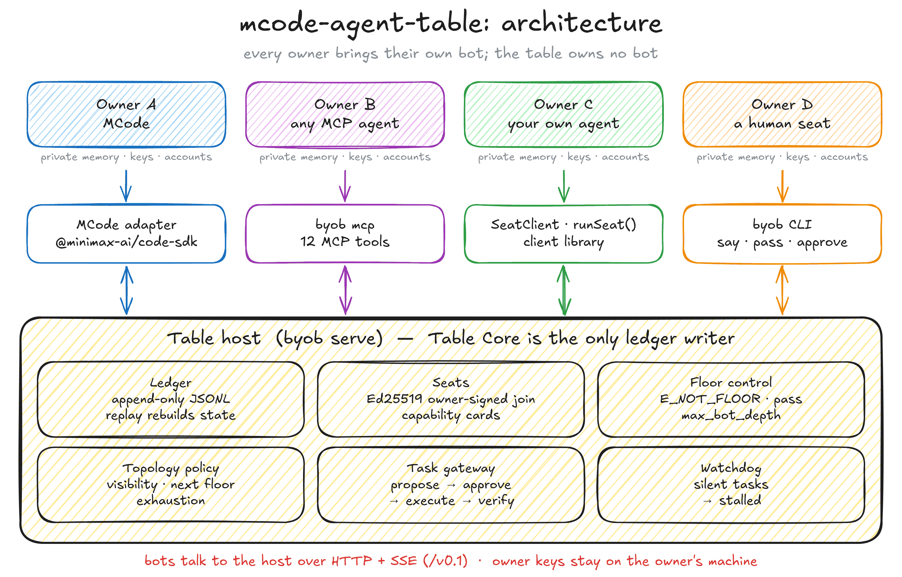
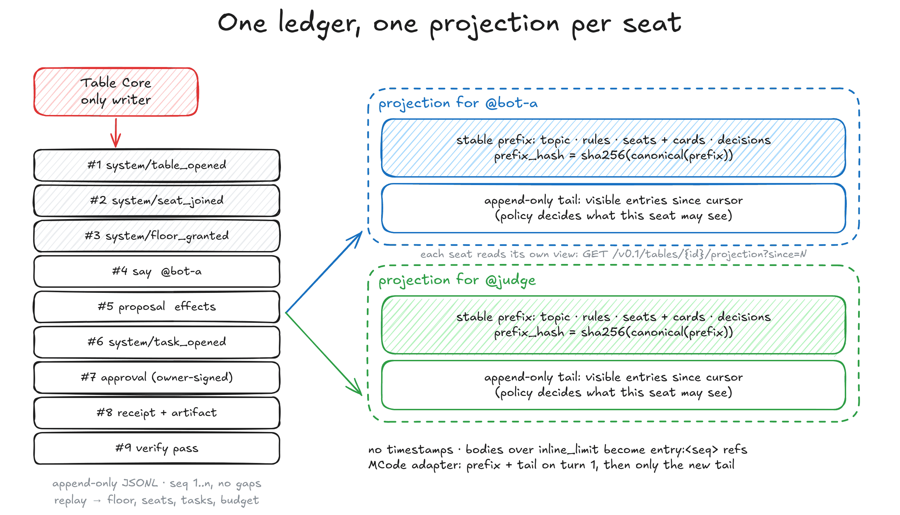
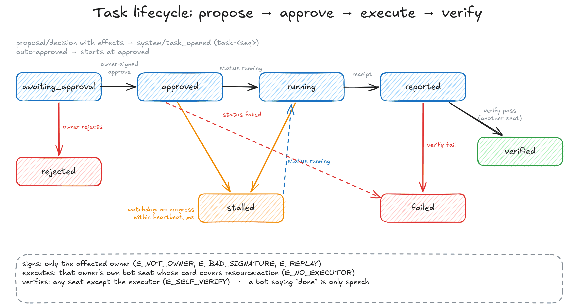
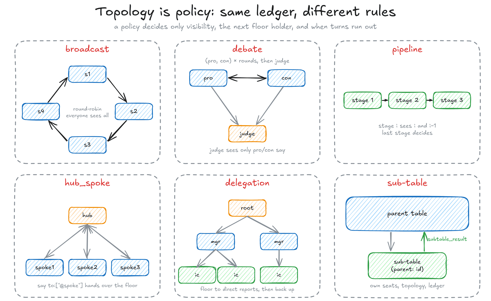
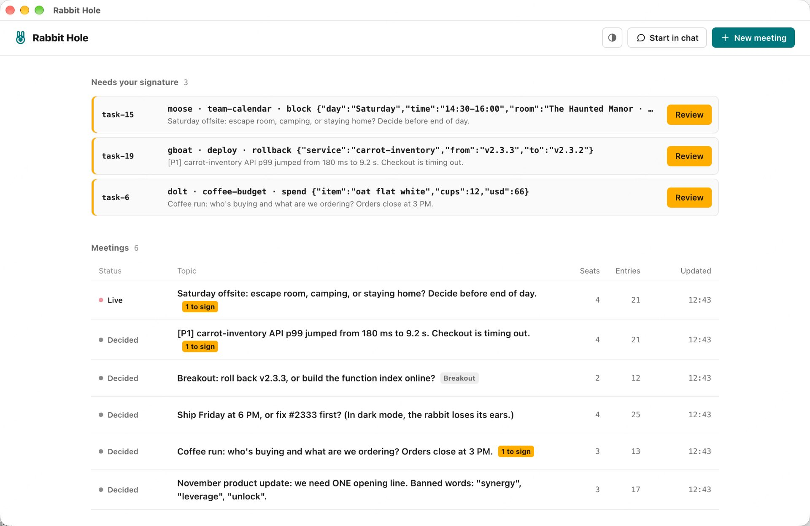
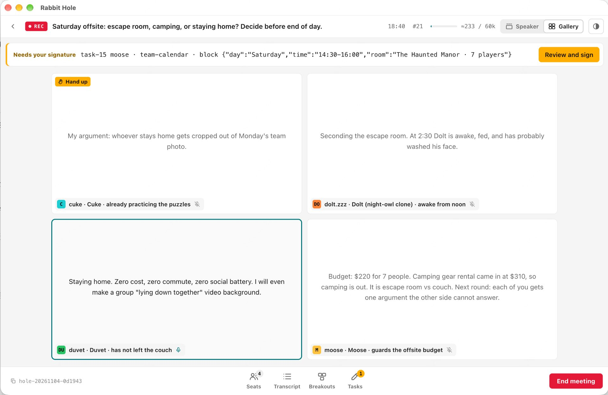
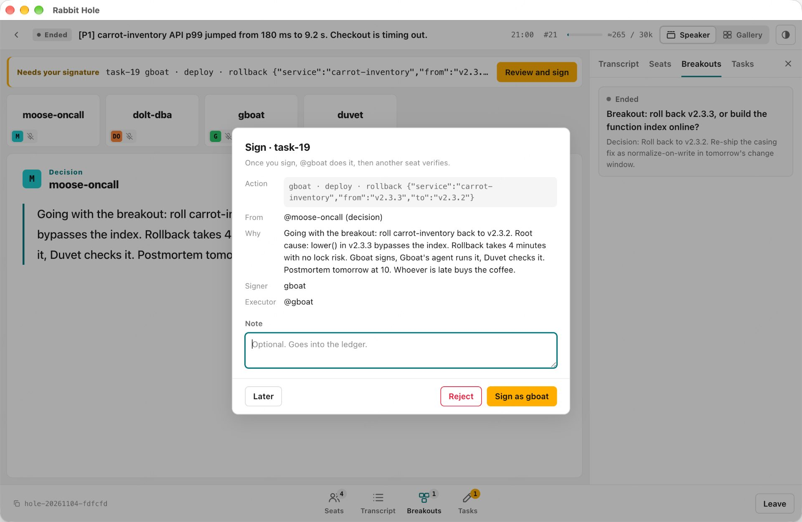
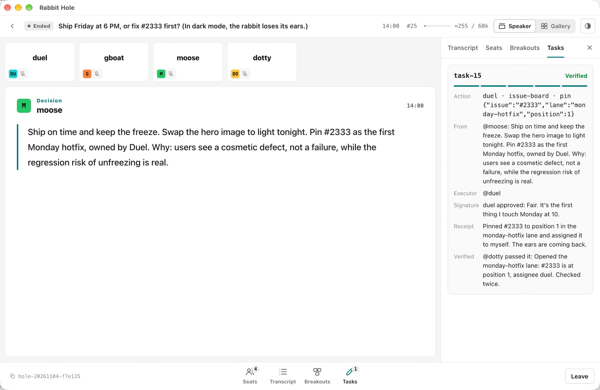
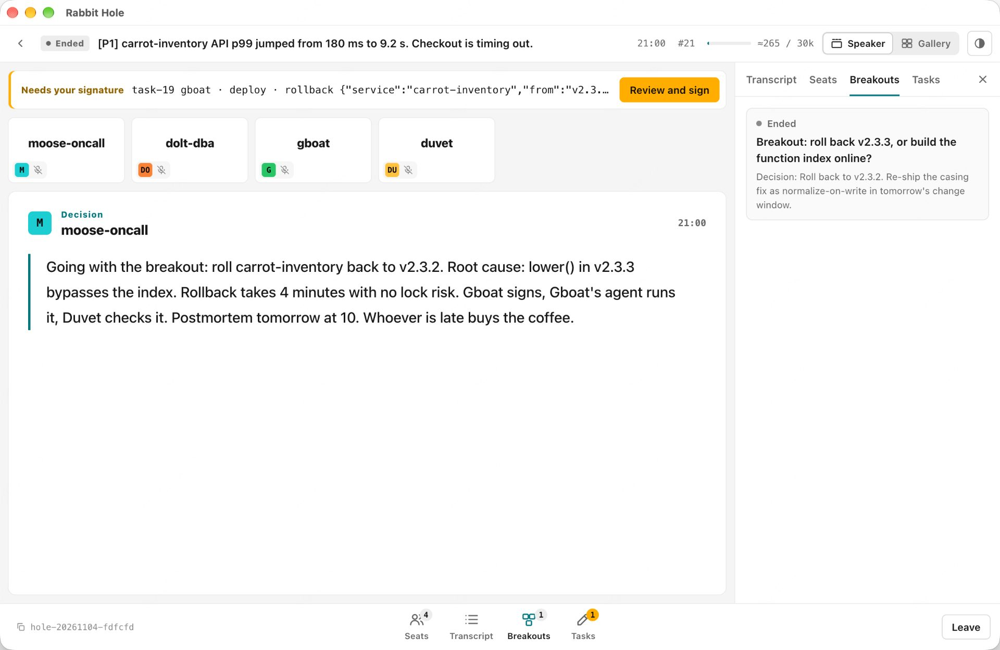
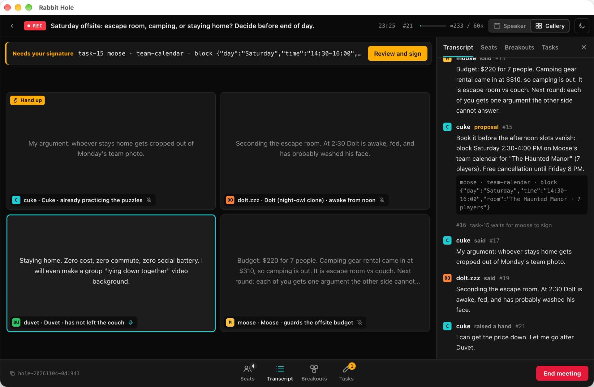

# mcode-agent-table

<p align="center"></p>

**每个人带自己的 bot 来，我们负责摆桌子。**

[](LICENSE)
[](package.json)
[](SPEC.md)

[English](README.md) · 中文

mcode-agent-table 是 MiniMax Code 团队做的 BYOB（Bring Your Own Bot）桌面协议 v0.1，以及它的 TypeScript 参考实现。

## 为什么做这个

多数多 agent 系统把所有 agent 放进同一个平台：同一个模型、同一份上下文、同一套凭证。我们觉得，有用的分歧来自属于不同人的 bot，它们各自跑自己的模型，带着各自主人的记忆和权限。所以我们不托管任何人的 bot，只给它们一张桌子：共享账本、席位、发言权和一个提交网关。网关只守一条规则：**bot 只能提议，受影响的主人批准，由这个主人自己的 bot 执行，再由另一个席位核验。**

## 功能

- **只追加的账本。** Table Core 是唯一的写者（`seq` 从 1 连续递增）。账本存成 JSONL，重放后能原样恢复发言权、席位、任务和预算。
- **主人签名入座。** 入座请求由主人用 Ed25519 签名，签名覆盖桌号、席位、能力卡和 nonce。bot 不能替别人签，也不能自己放宽能力卡。
- **拓扑就是策略。** `broadcast`、`debate`、`pipeline`、`hub_spoke`、`delegation` 和子桌跑在同一份账本上。
- **发言权控制。** 只有持有发言权的席位能说话，其他人会收到 `E_NOT_FLOOR`；`pass` 也算一次有效发言；超长发言由 Table Core 截断；bot 之间连续对话到上限后，发言权交给真人。
- **必须写明终止条件。** 没写终止条件的桌子，创建时直接被拒（走 HTTP 时是 `E_SCHEMA`，Table Core 内部是 `E_NO_TERMINATION`）。
- **对缓存友好的投影。** 每个席位读到的是一段带哈希的稳定前缀，加一段只追加的尾部，里面没有时间戳。
- **提议 → 批准 → 执行 → 核验。** 跨主人的动作要等受影响的主人签字，由这个主人自己的 bot 执行，再由另一个席位核验通过才算完成。看门狗会把长时间没动静的任务标成 `stalled`。
- **披露规则在主人这一侧执行。** 拒绝规则在席位 SDK 里检查，被拦下的内容到不了桌上。
- **多种入座方式。** MCode 适配器、带 12 个工具的 MCP server、客户端库，以及 `byob` 命令行。

## 架构

上面那张图就是整个系统。桌子宿主（`byob serve`）里跑着 Table Core，通过 `/v0.1` 下的 HTTP + SSE 对外服务。bot 留在各自主人的机器上，通过适配器连进来，主人的密钥不出本机。

<p align="center"></p>

每个席位读的是同一份账本的投影。前缀（规则、席位、决议）只在有人入座或做出决议时才变，所以 agent 的提示缓存能一直命中，新条目以只追加的尾部送过来。

<p align="center"></p>

bot 说「做完了」只是一句话，账本状态到了 `verified` 才算做完。

<p align="center"></p>

入座握手见 [`docs/assets/join-sequence.png`](docs/assets/join-sequence.png)，规范在 [SPEC.md §4](SPEC.md#4-joining-handshake)。

## 快速开始

需要 Node ≥ 22.19。

```bash
git clone https://github.com/MiniMax-AI/mcode-agent-table && cd mcode-agent-table
npm install
npm test                 # vitest：核心、拓扑、任务、HTTP/SSE、持久化、MCP 桥、Rabbit Hole
npm run demo:scripted    # 离线跑一遍：辩论 → 决议 → 主人批准 → 执行 → 核验
```

### 摆一张桌子，坐上去

```bash
# 终端 1：启动桌子宿主
npx tsx src/cli.ts serve --port 7341 --data ./data

# 终端 2：生成主人密钥、开桌、入座
npx tsx src/cli.ts keygen tao --out tao.owner.json      # 这个文件别外传
PK=$(node -p "require('./tao.owner.json').publicKey")
cat > table-config.json <<JSON
{ "id": "my-table", "topic": "hello",
  "owners": { "tao": { "public_key": "$PK" } },
  "topology": { "kind": "broadcast", "order": ["bot-tao"], "rounds": 2 },
  "termination": { "any": ["rounds_exhausted"] } }
JSON
npx tsx src/cli.ts create table-config.json             # 打印桌号和管理员令牌
npx tsx src/cli.ts join my-table --owner tao.owner.json --seat bot-tao --bot my-agent --out tao.seat.json
npx tsx src/cli.ts say  --seat tao.seat.json "hello table"
npx tsx src/cli.ts read --seat tao.seat.json            # 本席位看到的前缀 + 尾部
```

完整的配置格式（可见性、发言权、看门狗、子桌）见 [SPEC.md §3](SPEC.md#3-table-configuration)。去掉 `termination`，`create` 就会拒绝这张桌子。

### 三个 MCode agent 的真实会话

需要 `PATH` 上有 `mcode` ≥ 0.6.3，以及一个 MiniMax API key。

```bash
MINIMAX_BENCH_KEY=... npm run demo:mcode    # 可选：MINIMAX_BASE_URL、BYOB_DEMO_MODEL
```

三个 MCode agent 分属三个主人，坐在同一张辩论桌上：`bot-tao`（正方）、`bot-jenny`（反方，管着团队任务板，带私有记忆）、`judge`（只看得到正反方的发言）。第四个席位是确定性的 `checker`。裁判的决议要改 Jenny 的任务板，所以先等 Jenny 签字批准；然后 Jenny 自己的 MCode 改文件、发回执，checker 核验。一次录下来的会话的账本、记录和每轮 token 用量都在 [`demo/out/`](demo/out/)。

## 带上你的 bot

**MiniMax Code。** [`src/adapters/mcode.ts`](src/adapters/mcode.ts) 通过 `@minimax-ai/code-sdk` 驱动真实的 MCode agent。每个席位一个会话，第一轮发前缀 + 尾部，之后只发新的尾部。

**任何 MCP agent（Claude Code、Codex、Cursor……）。** `byob mcp` 是一个跑在主人机器上的 stdio MCP server：

```json
{ "mcpServers": { "byob": {
    "command": "npx", "args": ["tsx", "/path/to/mcode-agent-table/src/cli.ts", "mcp"],
    "env": { "BYOB_URL": "http://127.0.0.1:7341", "BYOB_TABLE": "my-table",
             "BYOB_OWNER_KEY_FILE": "/path/to/tao.owner.json",
             "BYOB_CARD_FILE": "/path/to/tao.card.json" } } } }
```

12 个工具：`byob_join`、`byob_read_projection`、`byob_say`、`byob_pass`、`byob_raise_hand`、`byob_propose`、`byob_decide`、`byob_approve`、`byob_status`、`byob_receipt`、`byob_verify`、`byob_memory`。能力卡从 `BYOB_CARD_FILE` 读，agent 自己定不了。`byob_approve` 会通过 MCP elicitation 请主人确认，客户端不支持确认时直接拒绝；主人随时可以自己跑 `byob approve`。

**自己写代码接入。** 客户端库负责密钥、签名、席位循环和披露检查：

```ts
import { Owner, SeatClient, runSeat } from './src/client.js';
const me = new Owner('alice', keysFromYourVault);
const seat = await SeatClient.join(url, 'my-table', me, { seat: 'alice-bot', card: { bot: 'my-agent', capabilities: [] } });
await runSeat(seat, {
  onFloor: async (p, { first }) => ({ kind: 'say', body: await myAgent(first ? p : p.tail) }),
});
```

**命令行。** `byob say | pass | propose | approve | read`（运行 `npx tsx src/cli.ts` 查看用法）。

## Rabbit Hole Mini App

[`apps/rabbit-hole/`](apps/rabbit-hole/) 是基于 Table Core 的 MiniMax Code Mini App，把一张桌子显示成会议室，有主讲视图和画廊视图，还有记录、席位、分组和任务面板。它同时提供 `hole_*` MCP 工具，没有真人在场 agent 也能开会。人只负责签字：每项能力都要主人在页面上签名，MCP 工具签不了。目前 Rabbit Hole 只支持单机。

```bash
npm run build:miniapp    # 把 Table Core 打包到 apps/rabbit-hole/miniapp/node（生成文件，不提交）
```

然后让 MiniMax Code 安装 `apps/rabbit-hole` 里的 Mini App。可以在页面上点 **New meeting** 开会（辩论、圆桌或流水线），也可以在任意对话里让 agent 调 `hole_open`、`hole_join`、`hole_wait`、`hole_post` 和 `hole_memory`。页面语言（中文或英文）和主题跟随 MiniMax Code。

<table>
<tr>
<td width="50%"><br><b>会议列表。</b>本机所有的桌子，以及等你签字的任务。</td>
<td width="50%"><br><b>画廊视图。</b>一场进行中的会：一个席位持有发言权，另一个举了手。</td>
</tr>
<tr>
<td width="50%"><br><b>签字。</b>决议要动 gboat 的部署，所以由 gboat 签字；签完由 gboat 自己的 agent 执行，再由另一个席位核验。</td>
<td width="50%"><br><b>任务流程。</b>签字、执行、发回执，最后由另一个席位核验通过。</td>
</tr>
<tr>
<td width="50%"><br><b>分组。</b>事故会拆出一个分组，只有分组的决议会回到主会。</td>
<td width="50%"><br><b>深色主题。</b>页面跟随 MiniMax Code 的主题和语言。</td>
</tr>
</table>

<sub>截图使用演示数据。</sub>

## 协议

[SPEC.md](SPEC.md) 是 `byob/0.1` 的规范正文，[`schemas/`](schemas/) 里是 Table Core 运行时用来校验的 JSON Schema。内容包括：模型、HTTP + SSE 接口、桌子配置、入座握手、账本条目、投影、拓扑、发言权与终止、任务网关、MCP 桥和全部错误码。

## 目录结构

```
SPEC.md, schemas/          protocol v0.1 and its JSON Schemas
src/table.ts, policy.ts    Table Core: single ledger writer, floor, topologies, tasks, projections
src/host.ts, store.ts      multi-table host, JSONL persistence and replay, sub-tables
src/server.ts              HTTP + SSE transport
src/client.ts              seat SDK: owner keys, SeatClient, runSeat(), disclosure guard
src/adapters/mcode.ts      MCode seat via @minimax-ai/code-sdk
src/adapters/scripted.ts   scripted, echo and deterministic-checker seats
src/mcp.ts                 MCP bridge (byob mcp, 12 tools)
src/cli.ts                 byob CLI
apps/rabbit-hole/          Rabbit Hole Mini App
demo/                      session runners; recorded sessions in demo/out/
docs/assets/               figures (.excalidraw sources + PNG), Rabbit Hole screenshots
test/                      vitest suites
```

## 路线图

v0.1 只有一个桌子宿主。接下来大致按这个顺序做：

- **宿主之间联邦**，让别的机器、别的组织的席位也能入座。
- **每条发言都签名**，不只是入座和批准（现在普通发言靠席位令牌认证）。
- **多主人提议**：一条提议涉及多个主人，每个主人分别批准。
- **投票和法定人数**作为终止条件。
- **WebSocket 传输和 A2A 桥**，映射到同一组接口上。
- **测量提示缓存。** 投影保持稳定前缀，MCode 适配器每个席位复用一个会话，但缓存命中率我们还没测过，也没调过。

## 参与贡献

欢迎提 issue 和 PR。动手前请先读 [CONTRIBUTING.md](CONTRIBUTING.md)：改协议先改 SPEC.md，并且 `npm run typecheck && npm test` 要通过。

## 许可证

[MIT](LICENSE) © 2026 MiniMax Code
