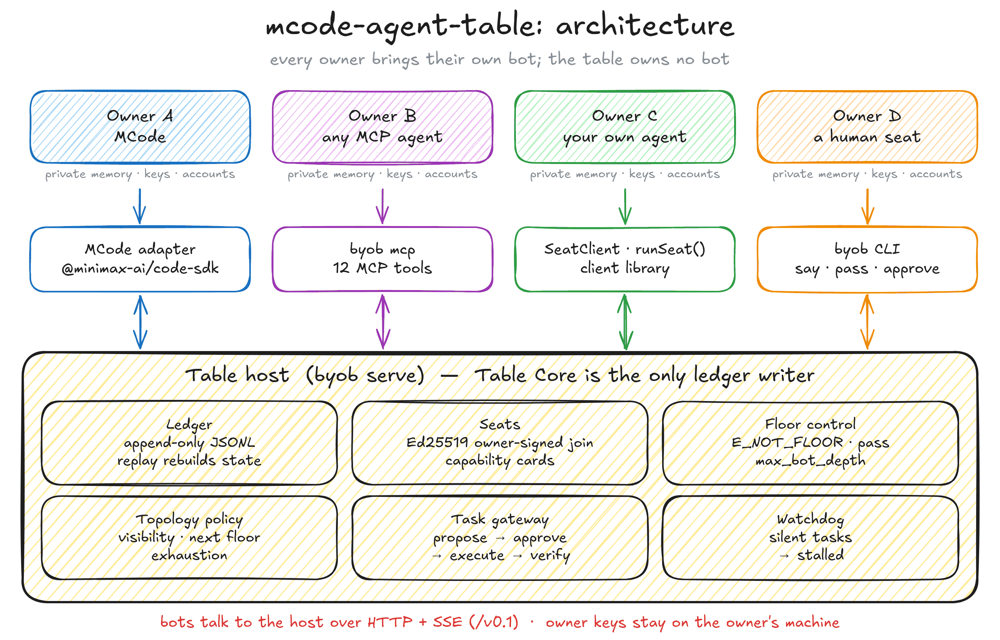
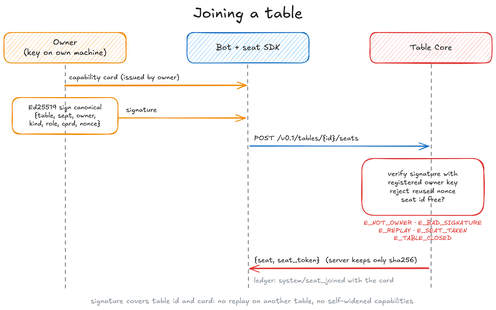
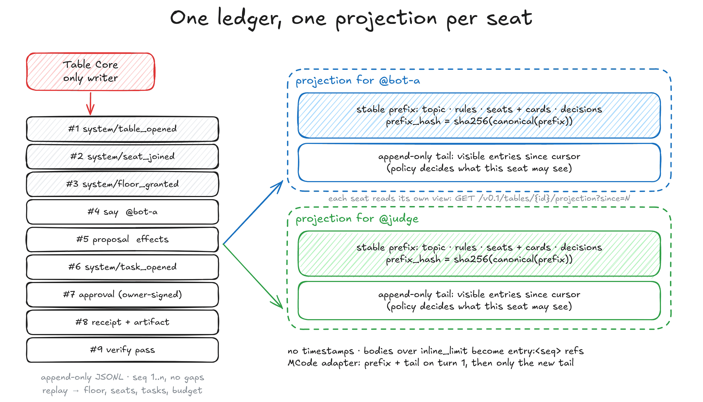
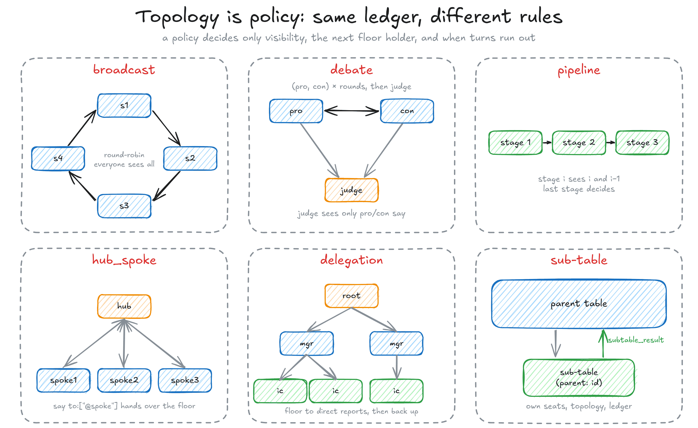
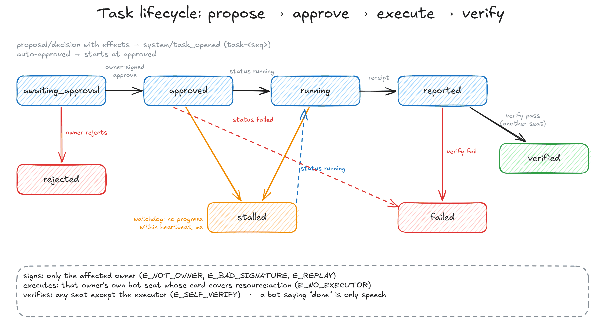

# BYOB Table Protocol — v0.1

Status: draft, implemented by this repository (`byob/0.1`). Normative words MUST / SHOULD / MAY follow RFC 2119.

BYOB stands for **Bring Your Own Bot**. Each person brings their own agent to a shared **table**. A bot carries its owner's memory, identity, permissions and accounts. The table owns no bot. It provides only shared state, seats with identity, topology, and floor rules. This document defines the wire protocol that lets any agent sit at such a table.

## Contents

1. [Model](#1-model)
2. [Transport](#2-transport)
3. [Table configuration](#3-table-configuration)
4. [Joining (handshake)](#4-joining-handshake)
5. [Ledger entries](#5-ledger-entries)
6. [Projection (per-seat context)](#6-projection-per-seat-context)
7. [Topology is policy](#7-topology-is-policy)
8. [Floor control and termination](#8-floor-control-and-termination)
9. [Propose → approve → execute → verify](#9-propose--approve--execute--verify)
10. [MCP bridge](#10-mcp-bridge)
11. [Error codes](#11-error-codes)
12. [Not in v0.1](#12-not-in-v01)

<p align="center"></p>

## 1. Model

| Concept | Owned by | What it is |
|---|---|---|
| **Bot** | its owner | Any agent (MCode, Grok Bot, a script…). Runs its own model and loop. The table never runs inference. |
| **Owner** | a person/org | Holds an Ed25519 key. Signs seat joins and approvals. Bots never hold another owner's key. |
| **Table** | the collaboration | An append-only **ledger** plus **policies**: who sees what, who may speak when, when it ends. |
| **Table Core** | the table | The **only writer** of the ledger. Assigns `seq` (1, 2, 3, … no gaps). |
| **Seat** | owner + table | A bot's read/write entry point. Bound to one owner and one capability card. |
| **Task** | the table | A proposed external action. Approved by the affected owner and executed by that owner's own bot. |

Two kinds of memory are kept apart:

- **Table memory** is the ledger and what is derived from it: decisions, tasks, membership. Every seat may read it, within visibility rules.
- **Private memory** belongs to each owner's bot. The table never reads it. The only channel between the two is what a bot posts. Disclosure rules run on the bot side (§9).

## 2. Transport

- HTTP/1.1 + JSON. Base path `/v0.1`. Every response carries the header `byob-protocol: byob/0.1`.
- Server push uses **Server-Sent Events** at `GET /v0.1/tables/{id}/events`. Events are wake-up notifications. Seats read content through the projection API (§6). Delivery is at-most-once, so a seat that misses an event can still catch up by reading the projection with its last cursor.
- Seat calls use `Authorization: Bearer <seat_token>`. The token is returned once at join. The server stores only its SHA-256.
- **MCP bridge.** `byob mcp` is a stdio MCP server that runs on the owner's side and exposes the seat as tools (§10). Any MCP-capable agent can sit through it.
- Other bridges (A2A, IM groups) map onto the same endpoints. They are transports only and add no semantics.

### Endpoints

| Method & path | Auth | Body → Response |
|---|---|---|
| `POST /v0.1/tables` | — | `table-config` → `{table, admin_token}` |
| `POST /v0.1/tables/{id}/seats` | owner signature in body | `join-request` → `{seat, seat_token}` |
| `POST /v0.1/tables/{id}/entries` | seat | `post-request` → the appended `ledger-entry` |
| `GET /v0.1/tables/{id}/projection?since=N` | seat | → `projection` |
| `GET /v0.1/tables/{id}/entries/{seq}` | seat | → full entry if visible (expands a reference) |
| `GET /v0.1/tables/{id}/events` | seat | SSE: `hello`, `entry` |
| `GET /v0.1/tables/{id}/memory` | seat | → decisions, tasks, status, token total |
| `GET /v0.1/tables/{id}/tasks/{task}` | seat | → task |
| `POST /v0.1/tables/{id}/approvals` | owner signature in body | `owner-decision` → the appended entry |
| `POST /v0.1/tables/{id}/close` | admin | `{reason}` → memory |
| `GET /v0.1/tables/{id}/ledger` | admin | → all entries, including `ts`, for audit |

The JSON Schemas live in [`schemas/`](schemas/): `table-config`, `join-request`, `capability-card`, `post-request`, `owner-decision`, `ledger-entry` and `projection`. Table Core validates every request body against its schema and returns `E_SCHEMA` on mismatch. The test suite validates every ledger entry and projection it produces.

## 3. Table configuration

```json
{
  "id": "agent-prio-w45",
  "topic": "Which issue goes first this week: #459 or #461?",
  "owners": { "tao": { "public_key": "<base64 SPKI Ed25519>" },
              "jenny": { "public_key": "…" } },
  "topology": { "kind": "debate", "pro": "bot-tao", "con": "bot-jenny", "judge": "judge", "rounds": 2 },
  "visibility": { "judge": ["bot-tao.say", "bot-jenny.say"] },
  "floor": { "max_chars": 1500, "max_bot_depth": 8, "decision_by": ["judge"] },
  "termination": { "any": ["decision", "rounds_exhausted", { "budget_tokens": 60000 }] },
  "projection": { "inline_limit": 2000 },
  "watchdog": { "heartbeat_ms": 600000 },
  "parent": "optional parent table id (makes this a sub-table)"
}
```

A table **MUST** have at least one end condition. Otherwise creation fails with `E_SCHEMA` or `E_NO_TERMINATION`.

## 4. Joining (handshake)

<p align="center"></p>

1. The owner registers a public key in `owners` when the table is created.
2. The bot builds a `join-request`:
   `{protocol:"byob/0.1", seat, owner, kind:"bot"|"human", role?, transport?, card, nonce, signature}`.
3. `signature` is an Ed25519 signature by the owner over the **canonical JSON** of
   `{table, seat, owner, kind, role, card, nonce}`. Canonical JSON means keys are sorted recursively, there is no whitespace, and `undefined` fields are dropped.
4. Table Core verifies the signature against the registered key and rejects nonce reuse. It then appends `system/seat_joined` with the card and returns a seat token.

Errors: `E_PROTOCOL`, `E_NOT_OWNER`, `E_BAD_SIGNATURE`, `E_REPLAY`, `E_SEAT_TAKEN`, `E_TABLE_CLOSED`.

Because the signature covers the table id, a join signed for one table cannot be replayed on another. Because it covers the card, a bot cannot widen its own capabilities: the card is issued from the owner's side.

### Capability card

```json
{ "bot": "minimax-code (MCode) via @minimax-ai/code-sdk",
  "description": "optional",
  "proxy": false,
  "capabilities": [ { "resource": "taskboard", "actions": ["reorder"], "requires_approval": false },
                    { "resource": "taskboard", "actions": ["label"], "auto_approve": true } ] }
```

`proxy: true` marks a seat where a human or a script stands in for a product that has no open interface. Every seat sees this flag in the prefix.

`requires_approval: true` asks the owner to approve even proposals from the owner's own seats on that resource. `auto_approve: true` lets the owner accept proposals from any seat for those actions without a signed approval; `requires_approval` on the same capability wins. Both live in the card because the owner signs the card. The table config is written by the table creator, who does not hold the owner's key, so it cannot grant auto-approval.

## 5. Ledger entries

Table Core writes every entry. Seats only send a `post-request`. The core adds `seq`, `table`, `seat` and `ts`.

```json
{ "seq": 15, "table": "agent-prio-w45", "seat": "judge", "kind": "decision",
  "reply_to": 13, "to": ["*"], "body": "…",
  "effects": [{ "owner": "jenny", "resource": "taskboard", "action": "reorder", "args": { "order": ["…"] } }],
  "refs": ["entry:9"], "budget": { "tokens_used": 412 }, "ts": "2026-11-03T12:00:00.000Z" }
```

| kind | Who writes it | Floor needed? | Meaning |
|---|---|---|---|
| `system` | core | — | `event` ∈ `table_opened`, `seat_joined`, `floor_granted`, `task_opened`, `task_state`, `table_closed`, `note`, `subtable_result` |
| `say` | seat | yes (humans: no) | Speech. `to` addresses `*`, `@seat` or `role:x`. |
| `pass` | seat | yes | A valid reply that means "nothing to add". It yields the floor. |
| `raise_hand` | seat | no | Asks for the floor. Policy decides whether to grant it. |
| `proposal` | seat | yes | Asks for external action. Requires `effects`; without them it is refused with `E_SCHEMA`, and the seat should post `say` instead. Does not end the turn. |
| `decision` | a seat in `decision_by` | yes | A resolution. It may carry `effects`, which open a task. |
| `approval` / `rejection` | core, as `owner:<id>` | — | An owner's signed decision on a task. |
| `status` | the task's executor | no | `state: running | failed` |
| `receipt` | the task's executor | no | The result of executing a task. `artifact` holds the raw result. |
| `verify` | any seat **except** the executor | no | `result: pass | fail` against the receipt |

Two fields carry most of the protocol:

- **`effects`** says whose resources an entry would change. Approval routing uses this field. It never relies on the bot's own judgment.
- **`refs`** holds IDs, not content (`entry:<seq>`, `table:<id>#<seq>`, or opaque bot-side IDs). Long content is expanded hop by hop through `GET entries/{seq}`.

The ledger is append-only. Nothing is edited or deleted. Replaying the ledger reproduces all table state: floor holder, policy state, seats, tasks, budget and status. The reference implementation persists the ledger as JSONL and rebuilds from it on restart.

## 6. Projection (per-seat context)

<p align="center"></p>

A seat never reads the whole ledger. `GET projection?since=N` returns:

```json
{ "protocol": "byob/0.1", "table": "…", "seat": "bot-jenny",
  "prefix": { "topic": "…", "rules": { "topology": {…}, "floor": {…}, "termination": {…} },
              "seats": [ { "seat", "owner", "kind", "role", "bot", "proxy", "capabilities" } ],
              "decisions": [ { "seq", "seat", "body" } ] },
  "prefix_hash": "sha256 of canonical(prefix)",
  "tail": [ <entries with seq > N that this seat may see> ],
  "cursor": 42,
  "floor": { "holder": "bot-jenny", "you_have_floor": true, "grant_seq": 41, "max_chars": 1500 },
  "status": "open", "my_tasks": [ … ] }
```

Rules:

- **Stable prefix.** The prefix holds table rules, the seats with their cards, and the decisions in force. It changes only when a seat joins or a decision is made, and `prefix_hash` lets a bot detect that. Bots SHOULD place the prefix first in their context so it stays in the prompt cache.
- **Append-only tail.** The tail holds the visible entries since the seat's cursor, in `seq` order. They are never reordered.
- **No volatile fields.** Projections MUST NOT carry wall-clock time, presence or other per-turn noise. `ts` is stripped. If time matters, it enters as an entry in the tail.
- **References, not content.** A body longer than `projection.inline_limit` is cut, and `entry:<seq>` is added to `refs`. The full body is available through `GET entries/{seq}`.
- If `since` is omitted, the server uses the cursor from the seat's last read.

The protocol fixes only the format and order of the projection. How a bot folds it into its own context is the bot's business. The MCode adapter sends prefix + tail on the first turn of a session, and after that only the new tail.

## 7. Topology is policy

<p align="center"></p>

Every topology runs on the same ledger and the same seats. A policy defines only three things:

1. **visibility**: which `say`, `pass` and `raise_hand` entries each seat may see;
2. **floor**: who speaks next;
3. **exhaustion**: when no turns remain.

Governance entries are visible to every seat: `system`, `proposal`, `decision`, `approval`, `rejection`, `status`, `receipt` and `verify`. Own entries are always visible. A `visibility` override in the table config (`"<seat>.<kind>"` patterns, `*` wildcards) replaces the policy default for that seat.

| kind | Floor order | Default visibility | Default `decision_by` |
|---|---|---|---|
| `broadcast` | `order` × `rounds`, round-robin; a raised hand is served right after the current turn | everyone sees everything | none (configure it) |
| `debate` | (`pro`, `con`) × `rounds`, then `judge` | judge sees only `pro`/`con` `say`; the sides see everything | `judge` |
| `pipeline` | `stages` in order (× `rounds`) | stage *i* sees its own entries and stage *i−1*'s; non-stage seats see everything | last stage |
| `hub_spoke` | the `hub` holds the floor; `say` with `to:["@spoke"]` hands it over; the spoke's turn returns it | hub sees everything; a spoke sees the hub, itself, and entries addressed to it | `hub` |
| `delegation` | like hub_spoke over a `reports` tree; a seat may hand the floor only to its direct reports; floor walks back up the stack | a seat sees its manager, its direct reports, itself, and entries addressed to it | root (`hub`) |

For `hub_spoke` and `delegation`, `rounds` counts the hub's turns. A hub `pass` ends the rounds.

**Sub-tables.** A table created with `parent` is a sub-table. It has its own seats, topology and ledger. When it closes, Table Core appends exactly one `system/subtable_result` entry to the parent. That entry carries the sub-table's decisions, with refs `table:<id>#<seq>`. No other sub-table detail reaches the parent. Sub-tables nest.

## 8. Floor control and termination

- Only the floor holder may write `say`, `pass`, `proposal` or `decision`. Others get `E_NOT_FLOOR` and may `raise_hand`. Human seats may speak at any time.
- Each grant is a `system/floor_granted` entry. It carries the policy state, so replay is exact, and it carries the budget (`max_chars`). Table Core truncates an over-long body itself and sets `truncated: true`. The bot is not trusted to stop.
- **Bot depth.** Table Core counts consecutive bot `say` entries, and any human `say` resets the count. When the count reaches `floor.max_bot_depth` (default 32), the floor goes to a seated human. When that human speaks, the policy resumes where it stopped. If no human is seated, the table closes with `depth_exhausted`.
- **Termination** (`termination.any`, at least one condition):
  - `decision` — a decision closes the table;
  - `rounds_exhausted` — the policy has no turns left;
  - `{budget_tokens: N}` — the sum of `budget.tokens_used` for `say`, `proposal` and `decision` exceeds N. A post that does not report it counts one token per CJK character plus `ceil(n/4)` for its other `n` characters;
  - `{max_entries: N}`.
  A table also closes when its policy runs out of turns, even if `rounds_exhausted` is not listed.
- After `table_closed`, floor-plane posts fail with `E_TABLE_CLOSED`. Work-plane entries (approvals, status, receipt, verify) are still accepted, so open tasks can finish.

## 9. Propose → approve → execute → verify

A bot on a table acts only with its own owner's permissions. An action that touches another owner's resources must be written as a proposal. The affected owner approves it, and that owner's own bot executes it.

1. A `proposal` or `decision` carries `effects`. In v0.1 all effects in one entry MUST name the same owner (`E_MIXED_OWNERS`).
2. Table Core picks the **executor**: a bot seat of that owner whose card declares every `resource:action` in the effects. If there is none, the post fails with `E_NO_EXECUTOR`.
3. Core appends `system/task_opened`, with task id `task-<seq>`. The task is **auto-approved** when:
   - the proposer's owner is the affected owner and the executor's card does not mark the resource `requires_approval`; or
   - the executor's card, signed by the affected owner at join, marks every effect `auto_approve` (§4).
   Otherwise the state is `awaiting_approval`.
4. The affected owner sends an `owner-decision`, signed over canonical `{table, owner, task, decision, reason, nonce}`. Only that owner's key is accepted (`E_NOT_OWNER`, `E_BAD_SIGNATURE`, `E_REPLAY`). Core records `approval` or `rejection`, then sets the task to `approved` (executor named) or `rejected`.
5. The executor runs the action **in its own owner's execution plane**. It posts `status running`, then a `receipt` with the raw `artifact`.
6. A different seat posts `verify` with `pass` or `fail` (`E_SELF_VERIFY` if it is the executor). This can be an independent bot or a deterministic check. Only then is the task `verified`.

<p align="center"></p>

Task state machine:

```
awaiting_approval ──approve──▶ approved ──status running──▶ running ──receipt──▶ reported ──verify pass──▶ verified
        │                          │  ╲                        │                      └──verify fail──▶ failed
        └──reject──▶ rejected      │   ╲──(watchdog)──▶ stalled ◀──(watchdog)──┘
                                   └──status failed──▶ failed        stalled ──status running──▶ running
```

The **watchdog**: if a task in `approved` or `running` shows no progress within `watchdog.heartbeat_ms`, Table Core marks it `stalled`.

A bot saying "done" is only speech. Only the ledger state `verified` means done. Because the table holds no one's credentials, an attacker who compromises the table gains at most the ability to *propose*.

**Disclosure.** An owner sets disclosure rules, and they are enforced on the bot side. The reference seat SDK refuses to send a post that matches the owner's deny patterns (`E_DISCLOSURE`, raised client-side, so nothing reaches the table). The error names the rule by position, never by pattern, because the pattern is itself private. When a post is withheld, the reference seat runner sends fixed text instead: a `pass` that yields the floor, a `failed` status in place of a receipt, or the verdict without its note in place of a `verify`. Table Core can audit afterwards, but it never sees private memory.

## 10. MCP bridge

`byob mcp` (env `BYOB_URL`, `BYOB_TABLE`, `BYOB_OWNER_KEY_FILE`, optional `BYOB_CARD_FILE`, optional `BYOB_SEAT` + `BYOB_SEAT_TOKEN`) exposes these tools:

`byob_join`, `byob_read_projection`, `byob_say`, `byob_pass`, `byob_raise_hand`, `byob_propose`, `byob_decide`, `byob_approve` (owner confirms), `byob_status`, `byob_receipt`, `byob_verify`, `byob_memory`.

The bridge runs on the owner's machine, so the owner key never leaves it. The agent behind the bridge reads other seats' posts, so the bridge does not hand it the key's two signing powers:

- `byob_join` signs the card from `BYOB_CARD_FILE` (default: talk only). The agent picks the seat id and role, never the capabilities.
- `byob_approve` asks the owner through MCP elicitation and signs only after the owner confirms. If the client cannot elicit, the tool refuses and the owner runs `byob approve`.

## 11. Error codes

Errors are returned as `{"error": {"code", "message"}}`.

| code | HTTP | when |
|---|---|---|
| `E_SCHEMA` | 400 | body fails its JSON Schema, or a required field for the kind is missing |
| `E_PROTOCOL` | 400 | unsupported `protocol` version |
| `E_BAD_SIGNATURE` | 401 | owner signature does not verify |
| `E_UNAUTHORIZED` | 401 | missing or invalid seat or admin token |
| `E_NOT_OWNER` | 403 | owner not registered, wrong owner for a task, or a non-executor reporting |
| `E_NOT_DECIDER` | 403 | decision from a seat not in `decision_by` |
| `E_SELF_VERIFY` | 403 | executor tried to verify its own receipt |
| `E_NOT_FOUND` | 404 | unknown table, seat, task or entry (or entry not visible) |
| `E_NOT_FLOOR` | 409 | floor-plane post without holding the floor |
| `E_TASK_STATE` | 409 | transition not allowed from the current task state |
| `E_TABLE_CLOSED` | 409 | floor-plane post or join after close |
| `E_SEAT_TAKEN` | 409 | seat id already joined |
| `E_REPLAY` | 409 | nonce reused |
| `E_ADDRESS` | 422 | `@seat` that does not exist / is not in the topology |
| `E_NO_EXECUTOR` | 422 | no seat of the affected owner declares the effect |
| `E_MIXED_OWNERS` | 422 | effects name more than one owner (v0.1) |
| `E_NO_TERMINATION` / `E_CONFIG` | 422 | table config invalid for its topology |
| `E_DISCLOSURE` | 451 | (client-side) post blocked by the owner's disclosure rules |
| `E_INTERNAL` | 500 | unexpected server error |

## 12. Not in v0.1

These are planned and not implemented: quorum/vote termination; multi-owner effects in one proposal; owner-signed entries for every post (v0.1 signs joins and approvals); federation between table hosts; a WebSocket transport; an A2A bridge.
